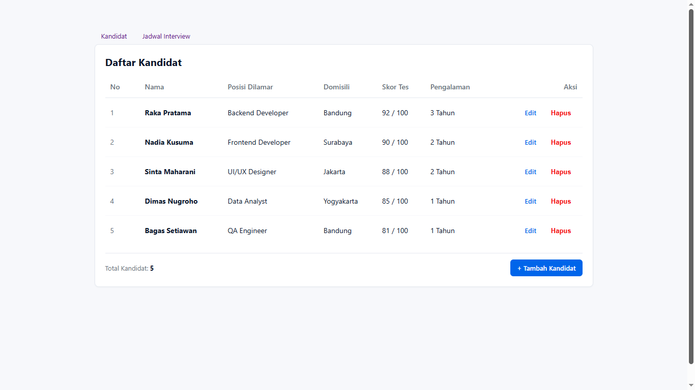
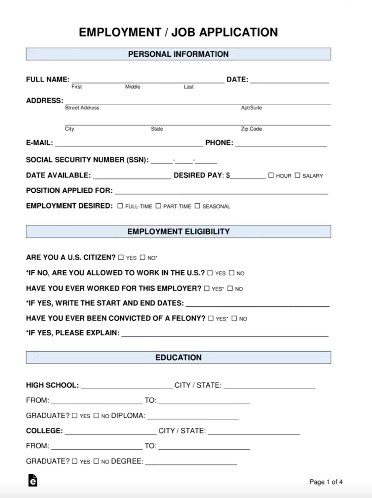

> "Saya Rama Taufik Azkia dengan NIM 2508497 mengerjakan Tugas Praktikum 9 dalam mata kuliah Desain dan Pemrograman Berorientasi Objek untuk keberkahanNya maka saya tidak melakukan kecurangan seperti yang telah dispesifikasikan. Aamiin."

*— Janji*

# GARIS BESAR TEMA
`MVP Kandidat` merupakan aplikasi berbasis web untuk mengelola data kandidat karyawan dan jadwal interview. Aplikasi ini menggunakan arsitektur *Model-View-Presenter* (MVP) (cek [catatan](#CATATAN)) versi *strict passive view*, dimana view dibuat se-pasif mungkin hingga hanya menampilkan saja dan tidak mengandung logika bisnis sedikit pun.

# DESIGN DATABASE
Program terdiri dari 2 tabel:
  1. `kandidat`, yaitu data kandidat karyawan yang melamar;
  2. `jadwal_interview`, berisi data penjadwalan *interview* kandidat serta status mereka setelah *interview*. Di tabel ini, atribut `waktu`, `tempat`, dan `status` dibuat *nullable* karena pada praktiknya, agar HR bisa membuat *record* kosongan terlebih dahulu yang bisa diperjelas nanti untuk waktu dan tempatnya, yang mungkin bisa jadi tidak menentu tergantung kondisi;

# ALUR
Saat pertama kali menjalankan aplikasi, pengguna akan disambut langsung dengan laman `Kandidat`:

Ini bukanlah kesalahan, karena aplikasi ini memang tidak memiliki laman beranda khusus, dan laman `Kandidat` dijadikan sebagai laman *default* atau *homepage*. Dari sini, pengguna bisa melihat langsung data-data apa saja yang ada di tabel `Kandidat`. Untuk menambah data baru, tekan tombol 'Tambah Kandidat'. Untuk merubah dan menghapus data, terdapat tombol 'Edit' dan 'Hapus' pada masing-masing baris.

Laman `Jadwal Interview` dapat diakses lewat tombol navigasi di paling atas laman, yang memiliki sistem CRUD yang sama dengan laman `Kandidat`.

# DOKUMENTASI (VIDEO)
[Dokumentasi Lengkap](docs/screenrecord.mp4)

# CATATAN
Ketika hendak menjalankan aplikasi, karena menggunakan PHP, pastikan *server* lokal dan SQL sudah aktif. Setelah itu, import *file* SQL [ini](mvp_db.sql).

Jika hendak merubah nama *database* atau menggunakan kredensial SQL selain `root`, ubah di file [config.php ini](project/config.php) karena seluruh program di aplikasi secara *default* merujuk pada kelas `Config` ini untuk mendapat informasi *database* dan kredensial akun. *(psst, jumpscare warning below)*

